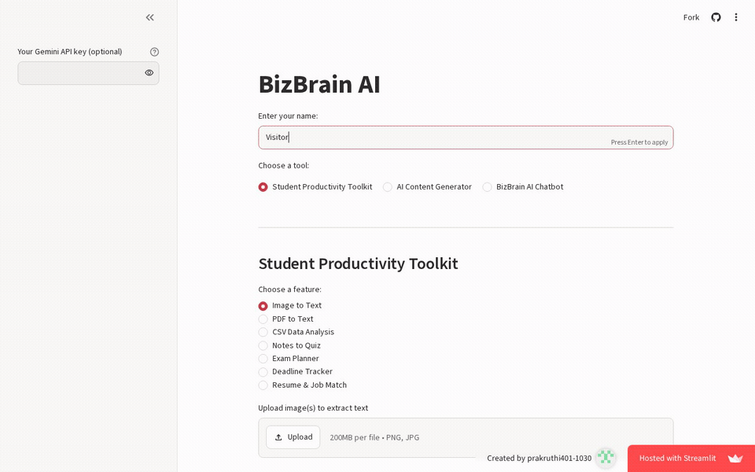

**Live app:** https://bizbrain-ai.streamlit.app/

# BizBrain AI


A Streamlit app with three AI tools in one place:

- **BizBrain AI Chatbot** - chat with three personalities (Friendly, Professional, Funny), powered by Google's Gemini model.
- **AI Content Generator** - draft formal letters, emails, stories, blog posts and social media posts from a short prompt.
- **Student Productivity Toolkit** - extract text from images (OCR) and PDFs, ask questions about a CSV dataset, turn notes into a quiz, plan exam revision, pull deadlines out of a circular or email, and match a resume against a job description.

## Setup

1. Clone this repo
2. Install the dependencies:

   ```
   pip install -r requirements.txt
   ```

3. Get a free Gemini API key at [aistudio.google.com](https://aistudio.google.com) and set it:

   - Locally: `export GEMINI_API_KEY=your-key` (see `.env.example`)
   - On Streamlit Cloud: App settings -> Secrets, add `GEMINI_API_KEY = "your-key"`

   The image/PDF tools work without a key; the chatbot, content generator and CSV Q&A need one.

4. Run it:

   ```
   streamlit run app.py
   ```

## Notes

- Image text extraction uses Tesseract OCR. On Streamlit Cloud it installs automatically via `packages.txt`. Locally, install it with your package manager (e.g. `sudo apt install tesseract-ocr`).
- `Global_Education.csv` is a sample dataset (UNESCO out-of-school and completion rates) to try the CSV analysis tool.
- Models: `gemini-3.1-flash-lite` first, falling back to `gemini-3.5-flash` (set at the top of `app.py`).

## Demo


